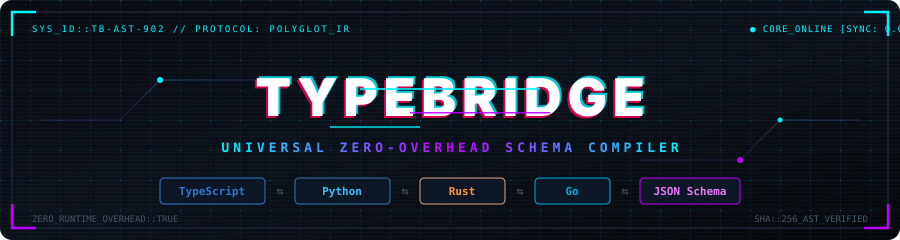

<div align="center">



<p>
  <a href="https://github.com/DHEENA0007/typebridge/actions/workflows/ci.yml"></a>
  <a href="https://securityscorecards.dev/viewer/?url=github.com/DHEENA0007/typebridge"></a>
  <a href="https://www.npmjs.com/package/typebridge"></a>
  <a href="LICENSE"></a>
</p>

</div>

TypeBridge is a cross-language schema compiler. Write your data models once in TypeScript or JSON Schema, and TypeBridge compiles them into native, idiomatic data structures across Python, Rust, Go, and TypeScript with zero runtime overhead.

Try it out in your browser with the zero-dependency [Interactive Playground](examples/playground.html).

---

## Why TypeBridge?

Most full-stack applications and distributed backends use more than one programming language:
- Python for AI services, FastAPI endpoints, and data pipelines
- Go or Rust for high-performance microservices and CLI tools
- TypeScript for web apps, React/Next.js frontends, and Node services
- JSON Schema for Model Context Protocol (MCP) tool calling and OpenAPI specifications

Maintaining the same data structures manually across three or four languages is tedious and leads to silent schema drift—a renamed field or missing nullable check in one service breaks another in production.

TypeBridge solves this by treating your types as code that can be compiled. You define the canonical model once, and TypeBridge generates the exact language-native structs, Pydantic models, Serde definitions, and validation schemas automatically.

---

## Supported Targets

| Language / Format | Output Style | Target Libraries |
| :--- | :--- | :--- |
| **Python** | Pydantic v2 `BaseModel` or `@dataclass` | `pydantic >= 2.0`, Python 3.10+ |
| **Rust** | `pub struct`, `pub enum` | `serde` (`Serialize`, `Deserialize`) |
| **Go** | `type ... struct` with JSON tags | `encoding/json`, Go 1.20+ |
| **TypeScript** | `interface` + optional Zod schema | `zod >= 3.0`, TypeScript 5.0+ |
| **JSON Schema** | Draft 2020-12 / OpenAPI 3.1 | Claude MCP tools, OpenAPI specs |

---

## Quickstart

### 1. Installation

You can install TypeBridge locally in your project or run it directly with `npx`:

```bash
npm install --save-dev typebridge
```

### 2. Define a Source Schema

Create a TypeScript file with your shared domain models (e.g., `schema/models.ts`):

```typescript
/**
 * User account authorization levels
 */
export type UserRole = 'ADMIN' | 'MEMBER' | 'GUEST';

/**
 * Shared user profile entity
 */
export interface UserProfile {
  id: string;
  username: string;
  email: string;
  role: UserRole;
  isActive: boolean;
  age?: number;
  tags: string[];
  createdAt: Date;
}
```

### 3. Compile to Target Languages

You can compile targets individually or configure them once in a `typebridge.config.json` file:

```json
{
  "input": "schema/models.ts",
  "targets": [
    { "target": "python", "output": "backend/models.py", "options": { "usePydantic": true } },
    { "target": "rust", "output": "src/models.rs" },
    { "target": "go", "output": "pkg/models/models.go", "options": { "packageName": "models" } },
    { "target": "json-schema", "output": "dist/schema.json" }
  ]
}
```

Run batch compilation:

```bash
# Compile all configured targets in one command
npx typebridge

# Watch schema and recompile automatically on save
npx typebridge watch
```

You can also compile single targets directly from the command line:

```bash
npx typebridge generate -i schema/models.ts -t python -o backend/models.py
npx typebridge generate -i schema/models.ts -t rust -o src/models.rs
```

---

## Generated Code Examples

### Python (Pydantic v2)

```python
# Auto-generated by TypeBridge. DO NOT EDIT DIRECTLY.
from __future__ import annotations
from typing import Optional, List, Dict, Any
from enum import Enum
from datetime import datetime
from pydantic import BaseModel, Field, ConfigDict

class UserRole(str, Enum):
    ADMIN = "ADMIN"
    MEMBER = "MEMBER"
    GUEST = "GUEST"

class UserProfile(BaseModel):
    model_config = ConfigDict(populate_by_name=True)

    id: str
    username: str
    email: str
    role: UserRole
    is_active: bool = Field(..., alias="isActive")
    age: Optional[float] = None
    tags: List[str]
    created_at: datetime = Field(..., alias="createdAt")
```

### Rust (Serde)

```rust
// Auto-generated by TypeBridge. DO NOT EDIT DIRECTLY.
use serde::{Deserialize, Serialize};
use chrono::{DateTime, Utc};

#[derive(Debug, Clone, PartialEq, Eq, Serialize, Deserialize)]
pub enum UserRole {
    Admin,
    Member,
    Guest,
}

#[derive(Debug, Clone, PartialEq, Serialize, Deserialize)]
pub struct UserProfile {
    pub id: String,
    pub username: String,
    pub email: String,
    pub role: UserRole,
    #[serde(rename = "isActive")]
    pub is_active: bool,
    #[serde(skip_serializing_if = "Option::is_none")]
    pub age: Option<f64>,
    pub tags: Vec<String>,
    #[serde(rename = "createdAt")]
    pub created_at: DateTime<Utc>,
}
```

### Go

```go
// Code generated by TypeBridge. DO NOT EDIT.
package models

import (
	"time"
)

type UserRole string

const (
	UserRoleAdmin  UserRole = "ADMIN"
	UserRoleMember UserRole = "MEMBER"
	UserRoleGuest  UserRole = "GUEST"
)

type UserProfile struct {
	Id        string    `json:"id"`
	Username  string    `json:"username"`
	Email     string    `json:"email"`
	Role      UserRole  `json:"role"`
	IsActive  bool      `json:"isActive"`
	Age       *float64  `json:"age,omitempty"`
	Tags      []string  `json:"tags"`
	CreatedAt time.Time `json:"createdAt"`
}
```

---

## Preventing Schema Drift in CI

TypeBridge includes a `check` command designed for continuous integration. It verifies that generated files match your source schema, exiting with code `1` if any file has drifted:

```bash
# Verify all targets configured in typebridge.config.json
npx typebridge check

# Or verify a single target
npx typebridge check -i schema/models.ts -t python -o backend/models.py
```

### GitHub Actions Integration

You can use the official TypeBridge action in your workflows:

```yaml
name: Verify Schema Sync

on: [push, pull_request]

jobs:
  check-schemas:
    runs-on: ubuntu-latest
    steps:
      - uses: actions/checkout@v4

      # Zero-config check using typebridge.config.json
      - name: Verify All Schemas
        uses: DHEENA0007/typebridge@main
```

---

## Programmatic API

TypeBridge can also be used as a Node.js library in custom build scripts:

```typescript
import { parseTypeScript, compile } from 'typebridge';

const source = `
  export interface SensorReading {
    sensorId: string;
    temperature: number;
    recordedAt: Date;
  }
`;

// Parse source into language-neutral AST
const doc = parseTypeScript(source, 'sensor.ts');

// Compile into target code
const pythonCode = compile(doc, 'python');
const rustCode = compile(doc, 'rust');
const goCode = compile(doc, 'go', { go: { packageName: 'sensor' } });
```

---

## CLI Reference

```
typebridge [command] [options]

Commands:
  generate    Compile input schema into target language code
  check       Verify that output file matches source schema (CI gate)

Options:
  -i, --input    Source schema file path (required)
  -t, --target   Target: python, rust, go, typescript, json-schema (required)
  -o, --output   Destination output file path
  -h, --help     Show usage help
  -v, --version  Show version number
```

---

## Contributing

We welcome contributions! Adding a new generator (such as Swift, Kotlin, or C#) is modular and only requires implementing a single file under `src/generators/`.

Please see [CONTRIBUTING.md](CONTRIBUTING.md) for local setup instructions and [GOVERNANCE.md](GOVERNANCE.md) for our contributor ladder.

---

## Contributors ✨

Thanks goes to these wonderful people ([emoji key](https://allcontributors.org/docs/en/emoji-key)):

<!-- ALL-CONTRIBUTORS-LIST:START - Do not remove or modify this section -->
<!-- prettier-ignore-start -->
<!-- markdownlint-disable -->
<table>
  <tbody>
    <tr>
      <td align="center" valign="top" width="14.28%"><a href="https://github.com/DHEENA0007"><br /><sub><b>DHEENA0007</b></sub></a><br /><a href="https://github.com/DHEENA0007/typebridge/commits?author=DHEENA0007" title="Code">💻</a> <a href="https://github.com/DHEENA0007/typebridge/commits?author=DHEENA0007" title="Documentation">📖</a> <a href="#infra-DHEENA0007" title="Infrastructure">🚇</a> <a href="#maintenance-DHEENA0007" title="Maintenance">🚧</a> <a href="#projectManagement-DHEENA0007" title="Project Management">📆</a></td>
      <td align="center" valign="top" width="14.28%"><a href="https://github.com/KANAGARAJ-M"><br /><sub><b>Kanagaraj.M</b></sub></a><br /><a href="https://github.com/DHEENA0007/typebridge/commits?author=KANAGARAJ-M" title="Documentation">📖</a></td>
    </tr>
  </tbody>
</table>

<!-- markdownlint-restore -->
<!-- prettier-ignore-end -->

<!-- ALL-CONTRIBUTORS-LIST:END -->

This project follows the [all-contributors](https://github.com/all-contributors/all-contributors) specification. Contributions of any kind welcome!

---

## License

TypeBridge is licensed under the [Apache License, Version 2.0](LICENSE).
